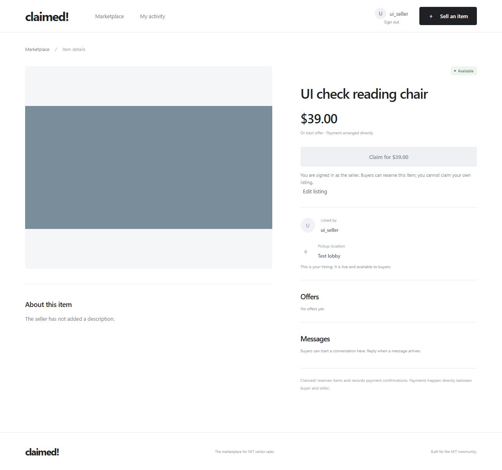
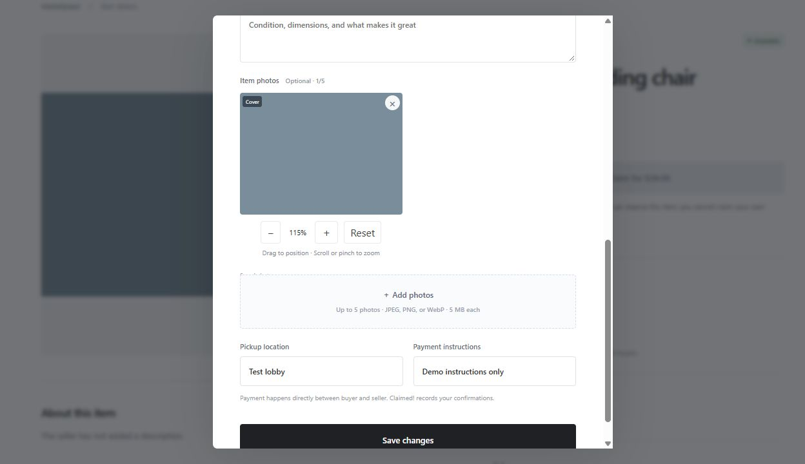
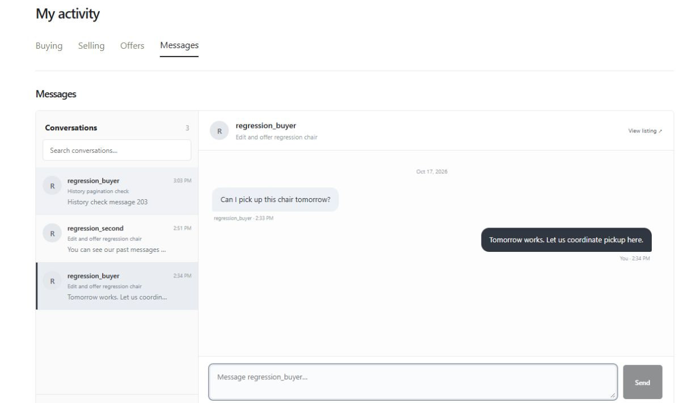

# Claimed! beta

The beta adds seller editing, photo framing, offers, optional payment evidence, and private messages while keeping the current visual design. Use [SETUP.md](SETUP.md) to run the app locally. [Implementation decisions](Notebook.md#entry-12-dialogs-framing-and-editing--october-17-2026) and [generated API contracts](backend/generated/claimed.md) describe the changes.

## Seller and buyer journey

1. Sign in as a seller and choose **Sell an item**. Add up to five photos. Drag each photo inside its preview to position it. Scroll, pinch, or use **+ / −** to zoom; **Reset** restores its centered, unzoomed framing. Arrow keys move the photo; +/− zoom and Home resets. The preview matches the cover's 4:3 crop. Item pages let viewers drag and zoom independently; **Fit image** reveals the complete photo. Set a price, enable **Allow offers (OBO)** if desired, and choose whether to require a payment screenshot.
2. Publish the listing. From **My activity → Selling** or the item page, **Edit listing** changes price, photos, description, tags, pickup, and payment instructions. If another edit was saved first, reopen the listing before retrying. Unpaid reservations keep their saved terms; payment-sent and sold listings cannot be edited.
3. In a second account, open the listing. Claim at the listed price or send an offer. Offers are nonbinding until accepted and leave the item available. Send the seller a private message to ask a question.
4. In the seller account, open **My activity → Offers** or the item page. Decline or **Accept & reserve** an offer. Only one reservation can succeed, including when full-price claims compete. Other proposals become superseded. Buyers can withdraw pending offers.
5. The buyer sees the agreed price and instructions under **Payment details**. Pay externally, attach a screenshot if required, and choose **I have paid**. Evidence is visible only to the buyer and seller. A screenshot does not verify receipt.
6. The seller checks payment and chooses **Confirm payment received**. The item leaves the marketplace and remains in activity history. Continue the private conversation to coordinate pickup. Before payment is reported, either participant can cancel; closed offers do not reopen.

Use **My activity → Messages** to open and reply to an exact conversation inline. A buyer starts the conversation; sellers choose among buyer threads. Drafts are kept separately while switching within the panel. Enter sends; Shift+Enter adds a line. Messages update without a page refresh.

## Validation evidence

| Check | Evidence |
| --- | --- |
| Account/session, image upload, browsing and sale journeys | Existing tests in backend/tests |
| Editing, offer races, frozen terms, private receipts, messaging, legacy records | backend/tests/beta.test.ts |
| Final test output | [Saved results](validation/beta-tests.txt) |
| Browser save/edit check | [Listing](validation/beta-ui.png) and [drag/zoom editor](validation/photo-editor.png) |
| Specification and type validation | `bun run check` and `bun run check:web` |
| Production bundle | `bun run build` |

Run the checks from backend with MongoDB available. Tests create unique databases and remove only those test databases. The browser check used a separate demonstration database, not existing marketplace data. A fresh narrated beta recording and testing with another person are still needed for submission evidence.

## Current limits

Payments are external; screenshots do not establish payment authenticity. The seller must verify receipt. Evidence is retained with the sale record. Messages support plain text, up to 100 recent conversation summaries and history loaded in pages of 200 messages; there are no attachments, push notifications, unread counts, moderation, or pagination beyond the 100-conversation inbox. Updates use three-second polling. Cross-concept crash recovery and unused public-image cleanup remain outside this version. Older reservations without snapshots use current listing instructions because their original terms were never recorded. The framework check passes with 30 advisory diagnostics; these are documented in the notebook rather than presented as a clean diagnostic run.

## Follow-up regression checks

The item gallery supports panning, zoom buttons, wheel/pinch zoom, and Fit image. Viewing does not change the saved cover. Per-photo viewer framing survives polling. Photo switching uses arrows or thumbnails so a pan does not switch images.

Browser checks saved and reopened price/tag/description changes, sent a decimal offer through the actual number input, and verified that the pending offer persisted after refresh. The number-input conversion bug was missed by earlier API-only tests and is documented in Notebook entry 17. [Follow-up results](validation/follow-up-tests.txt) and [browser evidence](validation/item-gallery-offer.png) record this pass. Refresh the browser to load a rebuilt frontend; backend source changes require a server restart, as described in SETUP.md.

## Activity and messaging priorities

Selling shows items awaiting payment confirmation first, other active items next, and sold items last. Buying places sold items last. Newest-first order is preserved within each group. Edit listing is available only before payment has been reported; both the UI and server enforce this rule.

The messaging inbox opens the selected buyer/listing thread directly, rather than navigating to a listing and choosing a buyer implicitly. Each thread has its own temporary draft. Refresh failures preserve loaded history and offer Retry. [Regression output](validation/messaging-activity-tests.txt), [conversation screenshot](validation/messaging-inbox.png), and [Selling order screenshot](validation/selling-order.png) document this pass. The isolated activity fixture script refuses to run against any database except claimed_regression_ui_20261017.

## Traditional chat layout

Messages now has a searchable conversation list and a selected-chat pane. Choose a person/listing to read past messages and reply. Your bubbles appear on the right; the other person's appear on the left. Each thread retains its draft while you switch conversations. Compact layouts have a Back to conversations control.

Use **Load earlier messages** at the top of the chat history to read older pages. New-message polling preserves the older pages you have loaded. History is private to the two participants, including its pagination cursors. The inbox still shows only the latest 100 conversations.

[Latest test results](validation/traditional-messaging-tests.txt) cover 19 tests and 212 assertions. Browser checks covered left/right alignment, switching and replying in separate conversations, retained drafts, and loading all 225 messages in a test thread. Restart the backend and refresh the browser after this update, since it adds a history endpoint as well as rebuilding the interface.

