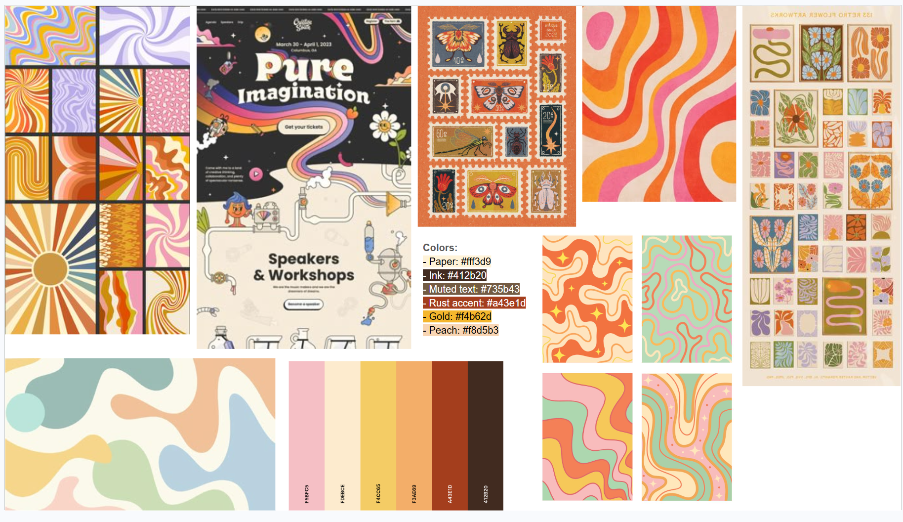
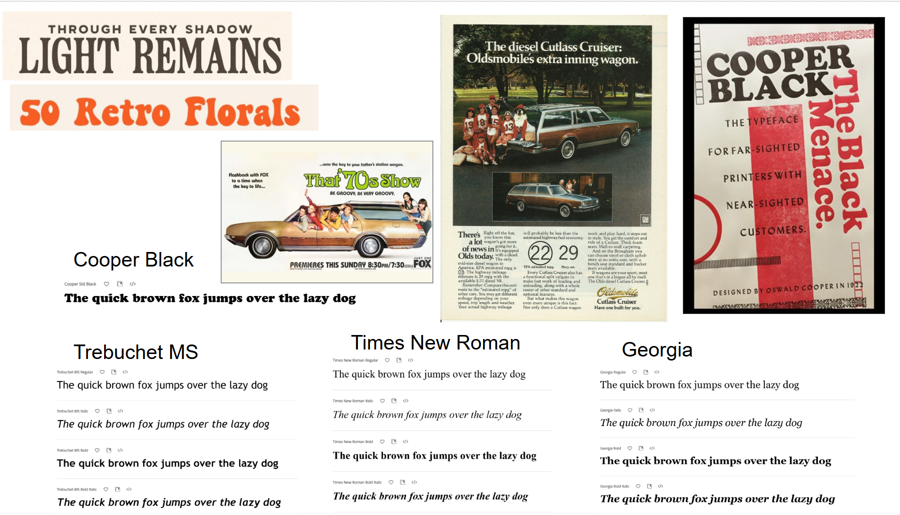

# Visual design study + annotations

## Overall direction

I want to go for a retro '70s vibe to match the thrifting element of Claimed! I really like the warm colors, wavy shapes, and chunky lettering of old posters, and I think they would make secondhand shopping feel fun and full of personality. I want to capture the feeling of finding something good at a thrift store, while still keeping buying and selling easy.

## Slide 1: Color

- **Wavy patterns and the orange/pink print:** I want to bring those flowing stripes into the background with peach, pink, and yellow ribbons. I feel like that would give the page some movement and help carry the '70s feel beyond just the fonts.
- **Stamps and floral prints:** I want to pull in the vintage warmth of the earthy oranges and browns, with softer peach and pink surfaces for tags and smaller details. I think those softer colors would let me keep the playful feeling without making everything compete for attention.
- **“Pure Imagination” website:** I like how playful this feels while still having clear sections. I want to try that balance by putting the intro text on a translucent cream surface over the waves, so the background can be fun without making the text hard to read.
- **Palette:** I'll use cream (`#fff3d9`) for the main background, dark brown (`#412b20`) for text, and a lighter brown (`#735b43`) for supporting details. I like how the cream and brown feel warm and vintage, and I think they would be comfortable to read together. I'll use rust (`#a43e1d`) for primary buttons and prices to help those stand out, with gold (`#f4b62d`) and peach (`#f8d5b3`) as smaller accents.
- **Color with a job:** I want filled rust buttons to make the main action easy to spot. I'll also keep words in the availability labels and payment steps, so people won't have to guess what a color means.

## Slide 2: Typography

- **Cooper Black poster and “50 Retro Florals”:** I really like the thick strokes and soft, rounded serifs. I want to use Cooper Black for the logo and major headings because I think it would give the site that friendly retro character right away.
- **Oldsmobile ad:** I want to borrow the contrast between the big serif headline and smaller supporting copy. I think that would help people find the main sections without making descriptions and transaction details feel just as loud.
- **Trebuchet MS:** I'll use this as the main font for body text and controls. I feel like its open shapes and relatively large lowercase letters would keep the practical information easy to read alongside the heavier headings.
- **Georgia and Times New Roman:** I want to use Georgia for listing titles and the italic phrase in the main headline to carry through the feel of the print references. I think its lighter appearance would help separate item names from the chunkier page headings. I'll also keep Georgia and Times New Roman as fallbacks if Cooper Black isn't available.
